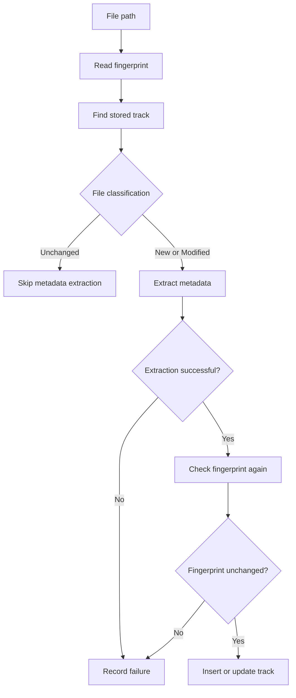
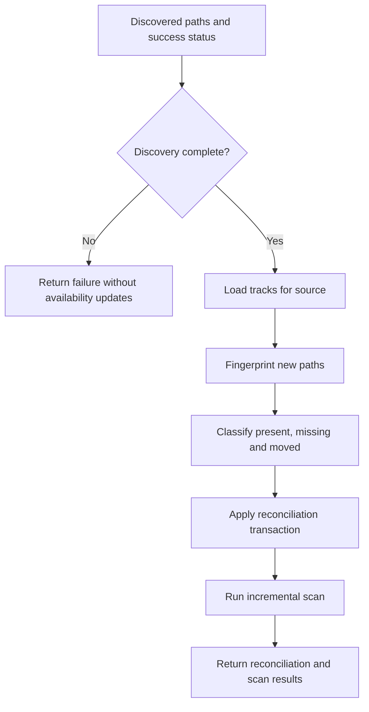
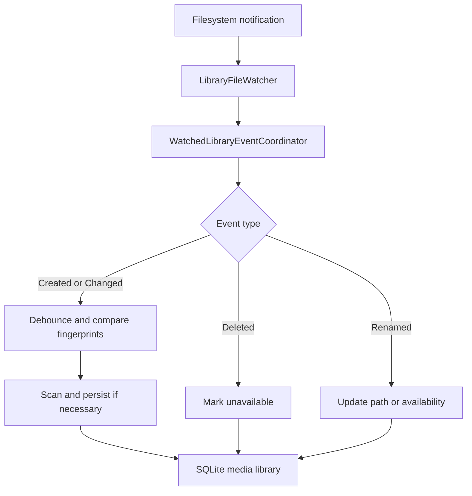

# Challenges 040–042 - Incremental Library Scanning, Reconciliation and File Watcher Updates

Introduces incremental media library scanning, reconciliation and event-driven library updates using filesystem fingerprints and SQLite persistence.

Challenge 040 avoids unnecessary metadata extraction for unchanged files. Challenge 041 reconciles persisted records against completed filesystem discoveries. Challenge 042 extends these capabilities with FileSystemWatcher notifications, debouncing and automatic SQLite updates when supported media files change.

## Concepts Practised

- Filesystem metadata and `FileInfo`
- File size and last-modified UTC timestamps
- Nullable database fields and SQLite schema migrations
- Change detection and set comparison
- Service composition and incremental processing
- Conditional persistence and database transactions
- Exception handling and failed-discovery safeguards
- Batch scanning and statistics
- Preserving persisted track identity
- `FileSystemWatcher`
- Asynchronous event handling
- Debouncing and event coordination

## Challenge 040 - Incremental Library Scanning

Challenge 040 introduces the `KaraokeCodingChallenges.IncrementalScanning` project and extends SQLite track records with filesystem fingerprints.

A fingerprint contains:

- `FilePath` - the full path to the media file.
- `FileSize` - the file size in bytes.
- `LastModifiedUtc` - the file's last-modified UTC timestamp.

These values allow files to be classified without extracting their embedded metadata on every scan.

### `FileFingerprint` and `FileFingerprintProvider`

`FileFingerprint` represents the current filesystem state. `FileFingerprintProvider` validates the supplied path, checks that the file exists, resolves its full path and retrieves its size and last-modified UTC timestamp.

### `FileChangeStatus` and `FileChangeDetector`

`FileChangeDetector` compares a current fingerprint with the previous persisted fingerprint. Supported classifications are:

- `New` - no corresponding stored track exists.
- `Modified` - file size or last-modified timestamp differs, or the stored fingerprint is incomplete.
- `Unchanged` - the current and previous fingerprints match.

### `IncrementalScanService`

Coordinates the existing media library repository, metadata reader and scan persistence service.

- `CheckFile()` classifies one file without reading its embedded metadata.
- `ProcessFile()` scans and persists one new or modified file, returning `null` when unchanged.
- `ProcessFiles()` processes multiple paths and returns a summary.

For new or modified files, the service retrieves a fingerprint, checks the stored track, extracts metadata, verifies the fingerprint again and persists the result only when extraction succeeds and the file has not changed during extraction.

Unchanged files are skipped without metadata extraction. Files that fail metadata extraction are not updated with a new fingerprint, allowing them to be retried.

### `IncrementalScanSummary`

Reports `Total`, `Added`, `Updated`, `Skipped` and `Failed` counts. Expected per-file filesystem exceptions are counted as failures without preventing subsequent files from being processed.

### SQLite Fingerprint Integration

Challenge 040 adds two nullable columns to `Tracks`:

| Column | SQLite type | Purpose |
|---|---|---|
| `FileSize` | `INTEGER` | Stored file size in bytes |
| `LastModifiedUtc` | `TEXT` | Stored UTC modification timestamp |

The database initializer adds missing columns to existing databases. They remain nullable to support records created before fingerprint persistence.

`MediaTrackRecord`, `MediaTrackRepository`, `ScannedTrackMapper` and `ScannedTrackPersistenceService` support inserting and updating fingerprints, retaining record IDs, and preserving existing values when no replacement is provided. Timestamps use an ISO 8601 round-trip representation.

### Incremental Scanning Workflow



## Challenge 041 - Library Reconciliation

Extends incremental scanning by comparing discovered filesystem paths against persisted SQLite tracks for a specific library source.

### Reconciliation Behaviour

`LibraryReconciliationService` identifies:

- **Present tracks** - their stored paths are included in the discovered paths.
- **Missing tracks** - their stored paths were not discovered and no move was identified.
- **Moved tracks** - an unambiguous match links a previously stored track to a newly discovered file.

Missing tracks are marked unavailable rather than deleted. Their IDs and existing metadata are preserved, allowing previously unavailable tracks to become available again when rediscovered.

`LibraryReconciliationResult` reports the source ID, stored and scanned counts, classified tracks, move matches and discovery-success state.

### Moved-File Detection

`FileMoveDetector` compares stored and newly discovered file fingerprints using file size and last-modified UTC timestamp.

A match is considered only within the same library source, with complete fingerprint data and differing old and new paths. A move is accepted only when the match is unambiguous in both directions: one stored track matches one new path, and vice versa.

Ambiguous candidates remain unmatched. Fingerprints are **heuristic**: different files can share a size and timestamp. No file-content hashing is performed in this challenge.

### SQLite Availability and Transactions

The `Tracks` table includes `IsAvailable INTEGER NOT NULL DEFAULT 1`, with a constraint limiting values to `0` or `1`. The initializer migrates existing databases to add the column when necessary.

`LibraryReconciliationPersistenceService` applies reconciliation inside a SQLite transaction:

- Missing tracks become unavailable (`IsAvailable = 0`).
- Present tracks become available (`IsAvailable = 1`).
- Moved tracks retain their ID while their path is updated and availability restored.

Updates are constrained by source ID. Failed updates or an unexpected original path cause rollback rather than partial application. Reconciliation results from failed discoveries are not applied.

### `LibraryScanOrchestrationService`

`Reconcile()` loads tracks for the source, safely reports unsuccessful discoveries without updating SQLite, fingerprints newly discovered paths and applies the resulting reconciliation for successful discovery.

`ProcessLibrary()` requires a completed filesystem discovery and coordinates both phases:

1. Compare discovered paths with persisted source tracks.
2. Fingerprint unknown paths and detect eligible moves.
3. Persist availability and moved-path changes transactionally.
4. Run `IncrementalScanService.ProcessFiles()` to insert new tracks, update modified tracks and skip unchanged tracks.
5. Return the reconciliation result and scan summary.

Reconciliation occurs before incremental scanning so moved files retain their existing IDs and are not inserted as duplicates. The two phases are **not** one shared database transaction.

**Discovery responsibility:** The caller supplies the scanned paths and an accurate `discoveryCompletedSuccessfully` flag. An incomplete filesystem discovery must not be presented as successful, as missing-track classification depends on a complete snapshot. A fingerprint-read failure before reconciliation is applied prevents partial reconciliation updates; individual metadata extraction failures during the subsequent scan are reported separately.

### Reconciliation Workflow




## Challenge 042 - File System Watcher Library Updates

Extends incremental scanning with filesystem notifications so supported media changes can update the SQLite library without requiring a full manual rescan.

### `LibraryFileWatcher`

Wraps `FileSystemWatcher` and monitors a configured directory, including its subdirectories.

Exposes notifications for:

- `FileCreated`
- `FileChanged`
- `FileDeleted`
- `FileRenamed`
- `WatcherError`

`RawFileChanged` provides optional diagnostic output before change notifications are debounced.

The watcher supports starting, stopping and disposal. Pending changed-file notifications are cancelled when appropriate.

### `FileEventDebouncer`

Consolidates repeated notifications for the same file path.

- Maintains separate pending operations for different paths.
- Cancels earlier pending callbacks when another event arrives for the same path.
- Supports cancelling all pending callbacks or those associated with a specific path.
- Uses cancellation tokens to avoid executing superseded delayed callbacks.

The default watcher debounce interval is 500 milliseconds.

### `WatchedLibraryUpdateService`

Coordinates existing media scanning, fingerprint detection and SQLite persistence.

Supported operations:

- `HandleCreated()` - scans a file and persists its metadata and fingerprint.
- `HandleChanged()` - compares fingerprints and rescans files when necessary.
- `HandleDeleted()` - marks a stored track unavailable without deleting its record.
- `HandleRenamed()` - updates a stored file path while preserving the track ID.

Unchanged, available tracks skip unnecessary metadata extraction. Previously unavailable tracks can be processed again when their files reappear.

Rename conflicts are rejected when the destination path already belongs to a different stored track.

### `WatchedLibraryEventCoordinator`

Connects `LibraryFileWatcher` notifications to `WatchedLibraryUpdateService`.

Each coordinator is associated with a library source ID and a karaoke classification flag.

Created and changed notifications use deferred processing. Deletion and rename notifications cancel relevant pending operations before updating the database.

The coordinator also:

- Filters supported file extensions.
- Handles renames between supported and unsupported extensions.
- Serializes its database update operations through a shared synchronization lock.
- Rechecks relevant filesystem state before applying operations.
- Reports processing failures through `ProcessingError`.
- Unsubscribes from watcher events and cancels pending work when disposed.

### Extension Transition Behaviour

| Operation | Behaviour |
|---|---|
| `.mp3` created | Scan and persist the track |
| `.mp3` modified | Compare fingerprints and update if changed |
| `.mp3` deleted | Mark the track unavailable |
| `.mp3` renamed to `.mp3` | Update the stored path and preserve its ID |
| `.mp3` renamed to unsupported extension | Mark the original track unavailable |
| Unsupported extension renamed to `.mp3` | Scan and persist the newly supported file |

### Event-Driven Update Workflow



### Scope and Limitations

- The current event coordinator processes `.mp3` as its supported primary media format.
- MP3+CDG companion-file updates are deferred to the Persistent Library Milestone (Challenge 044).
- Debouncing reduces duplicate processing but does not guarantee that a large file has finished copying.
- Transient scanning failures do not currently trigger an automatic retry.
- Synchronization protects coordinator-managed database operations but does not coordinate independent external writers.
- Filesystem notifications are not a substitute for periodic full-library reconciliation. Missed events or watcher failures may require a subsequent scan.

These limitations will be revisited during later integration and reliability work.

## Design Decisions

### Fingerprints Rather Than Content Hashes

File size and last-modified timestamps are inexpensive to obtain, but changes that preserve both values will not be detected. For Challenge 041, an unambiguous fingerprint match is sufficient to identify a potential move; a production karaoke application may require stronger identity verification.

### Preserve Existing Track Identifiers

Modified and moved tracks update existing SQLite rows instead of creating duplicates. Missing tracks remain persisted but unavailable.

### Failed-Discovery Protection

An incomplete discovery cannot safely establish which stored files are missing. Failed discoveries therefore do not trigger availability changes. Metadata scanning errors are handled separately from discovery completion.

### Transactional Reconciliation

Availability and move updates are applied together within a transaction. The subsequent incremental scan is a separate phase and is not covered by that reconciliation transaction.

## Testing

The `KaraokeCodingChallenges.IncrementalScanning.Tests` project contains **44 passing tests** across Challenges 040 and 041, covering fingerprint generation, incremental scanning, reconciliation, moved-file ambiguity, transactional persistence and orchestration.

Temporary SQLite databases and filesystem files are used for integration tests. At the completion of Challenge 041, the full solution had **366 passing tests** (zero failed, zero skipped).

See the test project README for detailed coverage and the historical Challenge 040 counts.

## Demonstration

`KaraokeCodingChallenges.IncrementalScanning.Demo` demonstrates six passes:

1. Initial scan - add three tracks.
2. Repeat scan - skip three unchanged tracks.
3. Modified scan - update Queen while preserving its ID.
4. Missing file - mark ABBA unavailable while preserving its ID.
5. Moved file - relocate Fleetwood Mac, update its stored path and preserve its ID.
6. Restored file - restore ABBA's availability and rescan its changed contents.

A failed-discovery example confirms no tracks are classified as missing. The demo finishes with three available tracks and their original IDs.

Run from the repository root:

```powershell
dotnet run --project KaraokeCodingChallenges.IncrementalScanning.Demo
```

See the demo README for the full example output.

## Future Improvements

- Measure scanning performance across larger libraries.
- Consider content hashing or confirmation for stronger moved-file identification.
- Improve scan reporting, discovery diagnostics and partial-failure handling.
