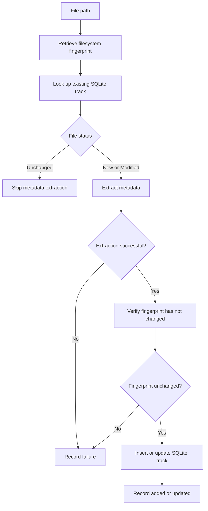

# Challenge 040 - Incremental Library Scanning

Introduces incremental media library scanning using filesystem fingerprints and SQLite persistence, allowing previously scanned files to be skipped when their contents have not been identified as changed.

Builds on Challenge 038 (Persist Scanned Tracks) and Challenge 039 (Database-Backed Search) by extending the persistent media library with change detection, selective metadata extraction, and multi-file scan statistics.

## Concepts Practised

- Filesystem metadata and `FileInfo`
- File size and last-modified timestamps
- UTC date and time handling
- Nullable database fields
- SQLite schema migrations
- Change detection and comparison
- Service composition
- Incremental data processing
- Conditional persistence
- Exception handling
- Batch processing and statistics
- Integration with existing repositories and services

## Implementation

The challenge introduces the `KaraokeCodingChallenges.IncrementalScanning` project and extends the existing SQLite persistence components to store and compare file fingerprints.

A fingerprint consists of:

- `FilePath` - the full path to the media file.
- `FileSize` - the file size in bytes.
- `LastModifiedUtc` - the last-modified timestamp in UTC.

These values allow the scanner to classify files without extracting their embedded metadata on every scan.

### `FileFingerprint`

Represents the current filesystem state of a media file.

The `FilePath`, `FileSize`, and `LastModifiedUtc` properties are used to compare a file against its previously persisted state.

### `FileFingerprintProvider`

Retrieves fingerprint information from the filesystem.

Responsibilities include:

- Validating file paths.
- Confirming that a file exists.
- Resolving the full file path.
- Reading the file size.
- Reading the last-modified UTC timestamp.

### `FileChangeStatus`

Defines the supported file classifications:

- `New` - no corresponding track exists in SQLite.
- `Modified` - an existing track has a different fingerprint or no previously stored fingerprint.
- `Unchanged` - the current fingerprint matches the stored values.

### `FileChangeDetector`

Compares the current fingerprint against a previous fingerprint.

A file is classified as modified when its size or last-modified timestamp differs from the previous values.

A missing previous fingerprint identifies a new file.

### `IncrementalScanService`

Coordinates incremental scanning using the existing media library database, metadata reader, and persistence services.

The service provides three main operations:

- `CheckFile()` - classifies an individual file without extracting its metadata.
- `ProcessFile()` - scans and persists an individual new or modified file, returning `null` when unchanged.
- `ProcessFiles()` - processes multiple file paths and returns aggregated scan statistics.

For new or modified files, the service:

1. Retrieves the current filesystem fingerprint.
2. Compares it with the existing SQLite record.
3. Extracts metadata only when processing is required.
4. Verifies that the file fingerprint has not changed during metadata extraction.
5. Persists the metadata and fingerprint when processing succeeds.

Unchanged files are skipped without invoking the metadata reader.

Files that fail metadata extraction are not updated with a new fingerprint, allowing them to be retried during subsequent scans.

### `IncrementalScanSummary`

Provides statistics for a batch scan:

- `Total` - number of input files processed.
- `Added` - number of new tracks successfully persisted.
- `Updated` - number of existing tracks successfully updated.
- `Skipped` - number of unchanged files skipped.
- `Failed` - number of files that could not be processed successfully.

Expected filesystem exceptions are handled individually during batch processing, allowing subsequent files to continue processing.

## SQLite Integration

The existing `Tracks` table has been extended with two nullable columns:

| Column | SQLite Type | Purpose |
|---|---|---|
| `FileSize` | `INTEGER` | Previously recorded file size in bytes |
| `LastModifiedUtc` | `TEXT` | Previously recorded UTC modification timestamp |

The database initializer supports existing databases by adding the fingerprint columns when they are missing.

The columns remain nullable to support tracks that were persisted before incremental scanning was introduced.

### Repository and Persistence Changes

The existing `MediaTrackRecord`, `MediaTrackRepository`, `ScannedTrackMapper`, and `ScannedTrackPersistenceService` have been extended to support fingerprint information.

Key behaviours include:

- Persisting fingerprints when new tracks are inserted.
- Updating fingerprints when existing tracks are rescanned successfully.
- Preserving existing fingerprint values when an update does not provide replacements.
- Preserving track identifiers when an existing file is updated.
- Avoiding fingerprint updates after unsuccessful metadata extraction.

Timestamps are stored in an ISO 8601 round-trip format to preserve their date and time information.

## Incremental Scanning Workflow



## Design Decisions

### Filesystem Fingerprints Instead of Content Hashing

The challenge uses file size and last-modified timestamps rather than calculating file-content hashes.

This avoids reading the entire file solely to determine whether it may have changed, making the approach suitable for incremental scanning.

However, changes that preserve both the file size and modification timestamp will not be detected.

### Preserve Existing Track Identifiers

Modified files update their existing SQLite records rather than creating duplicate tracks.

This preserves track identifiers and their relationships with other persistent library data.

### Verify Files After Metadata Extraction

The service checks the fingerprint again after metadata extraction.

If the file has changed during processing, the extracted metadata is not persisted with the earlier fingerprint.

### Continue Processing After Filesystem Failures

Batch processing handles expected filesystem exceptions on a per-file basis.

A missing or inaccessible file can therefore be counted as failed without preventing the remaining files from being scanned.

Unexpected exceptions are not silently ignored.

## Testing

The `KaraokeCodingChallenges.IncrementalScanning.Tests` project contains 24 tests covering fingerprint generation, change detection, single-file processing, batch processing, and failure handling.

SQLite integration tests verify persisted fingerprints and record updates using temporary databases.

See the test project README for further details.

## Demonstration

The `KaraokeCodingChallenges.IncrementalScanning.Demo` project demonstrates three successive library scans:

1. Initial scan - three new tracks are added.
2. Repeat scan - all three unchanged tracks are skipped.
3. Modified scan - one changed track is updated while two unchanged tracks are skipped.

The demo also verifies that the modified track retains its original SQLite identifier and that unchanged files do not trigger additional metadata reads.

Run the demo from the repository root:

```powershell
dotnet run --project .\KaraokeCodingChallenges.IncrementalScanning.Demo\
```

See the demo project README for the complete example output.

## Future Improvements

Potential extensions beyond this challenge include:

- Detecting removed or missing library files during reconciliation.
- Measuring incremental scanning performance across larger libraries.
- Evaluating content hashing when stronger change detection is required.
- Improving scan reporting and diagnostics.

Library reconciliation remains a separate planned roadmap item.